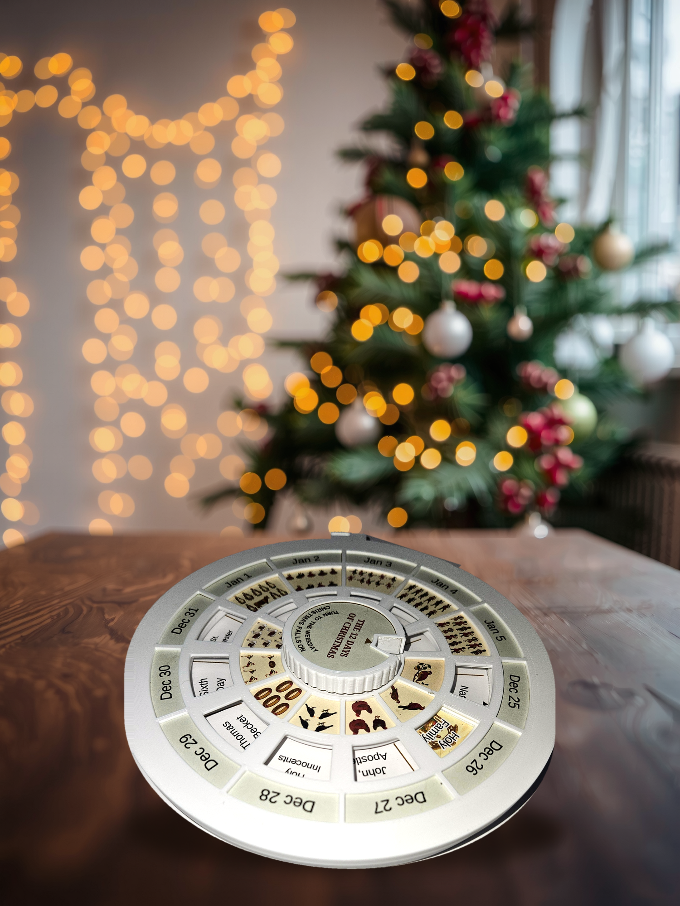

# The Twelve Days Calendar — a turning calendar for Christmas

## Summary

A round desk calendar for the twelve days of Christmas, December 25 to
January 5. Eleven of the twelve feasts are fixed to their date and never move.
Two are not: the Holy Family and the Epiphany are each kept on a Sunday, so
where they land depends entirely on the weekday Christmas falls on.

Turn the knob to that weekday and the wheel underneath slides two small plaques
into place, covering the fixed feast that the Sunday feast displaces. Set it
once in Advent and it is right for the whole season. It works in any year.

Ten printed parts (two optional extras besides), one thrust bearing and two screws.
It fits a 180 mm bed. Nothing is molded into the plastic — every word and
picture is on paper, held under a picture-frame top, so the labels are yours
to replace. Print the inserts at 100% with scaling off, or they will not fit.

---

## Print Settings

**Printer brand / model:** any FDM machine with a bed larger than 180 mm square.

**Rafts:** no
**Supports:** no
**Resolution:** not specified — the design does not depend on a layer height
**Infill:** not specified

**Filament:** PETG. The wheel is 2.4 mm thick and the detent clip is a spring;
PETG stays flat and takes flex without cracking, which is what those parts do
for a living.

### Notes

**It fits a 180 mm bed, but check the orientation.** The largest part is the
top frame at 173.4 × 167.8 mm lying flat — already inside 180 in both axes.
Turn it 30° on the plate and it comes down to a 167.8 mm square. The base
goes to 165.0 square at 26.5°. Do not measure your bed against a circle drawn
through the hanging tab: there is only one tab, so it never costs you both axes
at once.

**No supports anywhere.** The wheel's bearing recess bridges a 4 mm ring, and
the frame's snap bumps and skirt bead have 45° faces. **Print the hub spacer
flange down.** It used to be part of the wheel, standing on that bridge, and
it popped off with barely a touch.

**The files are STEP, one per part.** Every current slicer opens STEP
directly (PrusaSlicer, OrcaSlicer, Bambu Studio; Cura needs a plugin), and it is real geometry
rather than a mesh.

**The printed parts, in build order:**

| File | Part | Size | Print it |
|---|---|---|---|
| `base.step` | base | 172.0 × 165.0 × 12.6 mm | floor down |
| `top_frame.step` | top frame — the picture frame over the paper, all windows | 173.4 × 167.8 × 5.4 mm | **face down**, skirt up |
| `top_carrier.step` | top carrier — the flat disc the face paper is glued to | 158.3 × 158.3 × 1.0 mm | flat |
| `wheel.step` | wheel | 152.0 × 152.0 × 2.4 mm | flat, **recess down** |
| `bezel_holy_family.step` | bezel over the Holy Family tab | 31.9 × 28.3 × 3.8 mm | **face down**, hooks up |
| `bezel_epiphany.step` | bezel over the Epiphany tab | 23.6 × 23.9 × 3.8 mm | **face down**, hooks up |
| `knob.step` | knob — fluted side, flat top for its paper label | 43.7 × 43.0 × 7.0 mm | **top face down** |
| `hub_spacer.step` | hub spacer | 14.0 × 14.0 × 5.5 mm | **flange down** |
| `detent_clip.step` | detent clip | 9.4 × 29.0 × 6.4 mm | flat |
| `chicago_barrel.step` | Chicago barrel, plain M4 pilot the bolt taps — the axle | 11.0 × 11.0 × 11.6 mm | **head down, 100% infill** |

**Optional:**

| File | Part |
|---|---|
| `detent_clip_stiff_optional.step` | a firmer detent clip: its arm leans in 0.5 mm at the tip. Print it if your filament makes a soft spring and the settings don't click positively. |
| `knob_frame_optional.step` | a fluted sleeve pressed over the knob, 46.6 × 45.9 × 7.6 mm. Its rim hides the cut edges of the knob label; it pulls off again. **Print top face down.** |

The knob's paper label (on the face sheet) is glued over the knob's top and
covers the M4 screw head. To take the calendar apart, peel it and print another.

**Hardware you buy, not print:**

- 1 × F8-14M thrust bearing, 8 × 14 × 4 mm — sits in a pocket in the base floor
  ([Amazon](https://www.amazon.com/s?k=F8-14M+thrust+bearing+8x14x4))
- 1 × M4 × 12 screw, button head or socket cap — down through the knob into the
  barrel ([Amazon](https://www.amazon.com/s?k=M4+x+12mm+button+head+socket+screw))
- 1 × M3 × 12 **button head** screw (ISO 7380) — up through the wheel into the
  knob, cutting its own thread in the knob's pilot hole
  ([Amazon](https://www.amazon.com/s?k=M3+x+12mm+button+head+socket+screw)).
  It has to be a button head: a socket cap head is 3 mm tall against the
  button's 1.65, and under the wheel there is only room for the button.
  Don't go shorter than 12 mm either — at 10 the M3 holds by 3 mm of thread.

**Putting it together.**

1. **Labels.** Glue the base sheet into the base floor, its arrowhead on the
   index line. Glue the face sheet onto the top carrier — glue side up with the
   carrier's notch toward you, so the drive slot curves to the right. Glue the
   two tab labels into the wheel's tab recesses and snap a bezel over each: the
   hooks drop through the open slots either side of the tab and catch under the
   wheel.
2. **The top.** Lay the frame face down, set the carrier into the ring on its
   back with the carrier's notch on the frame's key, and press until the four
   bumps snap over its edge. The frame's lip now covers every paper edge, so a
   slightly ragged cut never shows.
3. **The axle.** Drop the bearing into the floor pocket and the detent clip
   into its pocket in the wall. Push the printed barrel up through the floor
   from below, set the wheel over it (the recess underneath sits over the
   bearing), and drop the hub spacer over the barrel, flange down onto the
   wheel.
4. **Close it.** Snap the top onto the base: its skirt clips over the wall on
   a bead, and a key lines it up. Put the knob on the spacer with the M3 hole
   over the wheel's. Run the M3 up from under the wheel first, then the M4 down
   from the top, holding the barrel with a flat screwdriver in the slot in its
   head. The barrel tops out on a shoulder inside the spacer, so the M4 clamps
   only the parts that turn: tighten it firmly and the wheel still spins on the
   bearing.

   **The barrel's head rubs the underside of the base, and that's expected.**
   The barrel turns with the knob, and its head runs against the plastic
   under the floor, so the dial has a light, even drag. That drag works with
   the detent clip to hold the setting where you leave it. If you'd rather it
   turned freer, slip a thin nylon or PTFE washer under the barrel head.
5. **Last, the knob label.** It covers the bolt hole. Press the optional knob
   sleeve on over it if you printed one.

---

## Post-Printing

### The labels

Nothing is lettered in the plastic — a home printer cannot hold type that
small. Every word and picture is on paper: the face sheet under the top frame,
the base sheet in the base floor, and small labels on the wheel tabs and knob.
The base sheet and the face sheet are included as PDFs in `files/inserts/`,
with a README naming free tools for changing the words on them. Print the base and `inserts_face`: the gifts inside, the
dates round the rim. Two alternate faces are there too: option A has the
dates inside and the gifts round the rim, B is A with the song lines. All
three cut to the same pieces.

**Print them at 100 percent with scaling off** — "Actual size" in the print
dialog, never "Fit to page" or "Shrink to fit". Prefer the PDFs: a PDF states
its page size, a PNG only hints at it, and a print dialog set to "fit to page"
will quietly shrink everything by two or three percent. Every sheet carries a
100 mm scale bar — measure it before you cut anything.

A laser print holds a crisper edge than inkjet and will not cockle thin stock,
so a print shop is worth the trip.

### Sticking them down

The floor of each recess prints like a first bridging layer: flat, but
threaded with fine ridges. That defeats a glue stick. What does hold:

- **Best: 3M 300LSE adhesive transfer tape (9472LE).** Made for low-energy
  plastics, and PETG is one. Put it on the back of the whole sheet before you
  cut, then cut the pieces out — the tape cuts with them. Wipe the recess with
  isopropyl alcohol, press each piece in hard (a spoon back or a roller) to push
  the adhesive into the ridges. It also holds laminated prints, since it bonds
  the laminate's plastic as well as it does the PETG.
- **Cheaper: 3M Super 90 spray.** Holds cardstock to PETG. Mist the back of the
  paper and the recess, wait about a minute until it is tacky, then press. Mask
  the rest of the part; overspray is hard to get off.
- **Tested: 3M Super 77 spray.** Used on the prototype and it works well.
  Same method as Super 90.

Mind the depth. The recess is 0.35 mm and the tape adds about 0.13, so keep
the paper (plus any laminate) to about 0.2 mm or it stands proud. Anything wet
enough to soak the paper — white glue, a wet glue stick — will buckle it.

### Three finishes from the same sheets

Because the labels sit in a recess rather than being printed on the part, the
same files give you a choice of material:

- **Cardstock.** Print at 100% with scaling off, cut, drop in. Costs nothing.
- **Laser-cut 1/16 in wood.** Looks like the object in your hands.
- **Photo-etched 0.4 mm brass**, enamel filled. The image is pigment rather
  than surface, so it stays crisp while the brass mellows around it.

---

## How I Designed This

Six detents, thirty degrees apart, for seven weekdays.

Tuesday and Sunday share one, and that is not a shortcut. In a Tuesday year and
in a Sunday year the Holy Family both times falls on December 30, and the
Epiphany both times lands outside the twelve days — January 6 after a Tuesday,
January 8 after a Sunday. Inside the season the two calendars read identically,
so one setting is the right answer for both.

The two window bands sit at different radii on purpose, so the Epiphany plaque
can never show through a December window. In the years when the Epiphany falls
after the twelve days, its tab passes behind the December days on a track where
they have no window, and stays hidden.

The settings were checked against the Church's rules for every Christmas from
2020 to 2100 — eighty-one years, all correct.

Designed in FreeCAD. The source model is included as `12days_calendar.FCStd`,
beside a STEP of each printed part.

The same files, and any revisions, are on GitHub:
https://github.com/rontidd/12daycalendar

and on Thingiverse:
https://www.thingiverse.com/thing:7427009

---

## Custom Section — the book

There is a book that goes with it: *The Twelve Days of Christmas — A calendar
of the octave, and the wheel that keeps it*. It takes the twelve days one at a
time and tells each one plainly — what is recorded, what is tradition, and what
was invented later by preachers and painters — with a map, the carol, ten
recipes beside their period originals, and this calendar at the back.

On Amazon:

- Kindle: https://www.amazon.com/dp/B0HP8LSH83
- Hardcover, with ruled pages of your own: https://www.amazon.com/dp/B0HPFJVNBN

The calendar does not need the book, and the files here are free either way.

---

## License

**Creative Commons — Attribution — Non-Commercial (CC BY-NC 4.0)**

Share it, remix it, build on it, with credit, for anything that is not
commercial. Full text in `LICENSE.md` and at
https://creativecommons.org/licenses/by-nc/4.0/

Shared as-is and as-available, without warranty. The author assumes no
liability for damages or injuries resulting from printing, assembly or use.

---

## Tags

christmas, calendar, advent, epiphany, twelve-days, perpetual-calendar,
mechanical, freecad, functional, holiday, desk, gift
